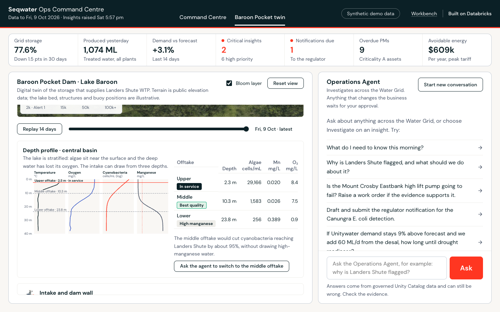

# Seqwater × Databricks: From reactive to proactive water operations

A self-contained executive demo of the **Databricks Data Intelligence Platform** for Seqwater. It goes past dashboards to show what leaders actually use:

- **Genie One**, on desktop and mobile, with **Skills** and **Scheduled tasks**. The 6:30am *Morning Operations Briefing* writes itself.
- **Proactive insights.** A daily engine finds what changed overnight, sizes the $ and risk impact, and recommends an action and an owner.
- **Agents that act.** The *Seqwater Operations Agent* is built with the **Agent Bricks CLI**. It investigates across the Water Grid, runs what-ifs, and raises work orders and regulator notifications, but only after a human approves.
- **Apps.** The *Seqwater Ops Command Centre* runs on Databricks Apps: briefing, KPIs, insight feed, agent chat and an action log.
- **A digital twin of Baroon Pocket Dam.** It shows Lake Baroon in 3D on public terrain at today's water level. You can replay the algal bloom spreading over 14 days, read the depth profile and its three intake offtakes, and ask the agent to switch to the cleaner layer. After you approve, the twin shows the new intake in service.
- **Governed by Unity Catalog** end to end: documented tables, keys, tags, certified metric views, least-privilege service principals, and MLflow traces of every agent step.

All data is **synthetic**. It uses real Seqwater asset names (Wivenhoe, Baroon Pocket, Mount Crosby, Landers Shute, Gold Coast Desalination Plant and others) with plausible magnitudes, and stays current: it regenerates to "yesterday" every morning at 5:15am Brisbane time.

> Tested on **Databricks on AWS**. It should work on Azure Databricks wherever the same features are enabled, but Azure has not been tested.

## Quick start

```bash
git clone <this repo> && cd seqwater-ai-demo
databricks auth login --host https://<your-workspace> --profile seqwater-demo   # once
./seqwater-demo install --profile seqwater-demo
```

That's it. About 15 minutes later the installer prints the links: Genie One, the Command Centre app, the Genie space and the data. Then follow **[docs/RUNBOOK.md](docs/RUNBOOK.md)** (also built as a PDF for presenters) for the 5-minute pre-meeting checklist and the demo script.

On Windows, use `python cli\seqwater_demo.py install --profile seqwater-demo`.

### Prerequisites

| Need | Why |
|---|---|
| Databricks CLI **v0.292+** (v1.x recommended), authenticated with a profile (OAuth) | Deploys bundles, apps, skills; runs SQL |
| Python **3.10+** and **[uv](https://docs.astral.sh/uv/)** | Runs the installer, and `uvx` fetches the Agent Bricks CLI (`databricks-agentbricks==0.5.0`) |
| A Unity Catalog **catalog** where you can create a schema (default `main`) | The demo schema `seqwater_demo` is created there |
| A **serverless SQL warehouse** (picked automatically) | Genie, metric views, the agent's SQL tools |
| **Serverless jobs**, **Genie One**, **Databricks Apps**, **Agent Bricks custom agents (Beta)** enabled | The experience layers |
| A foundation model endpoint that supports `ai_query` (default `databricks-claude-sonnet-4-6`; falls back to Sonnet 4.5, then Llama 3.3) and the AI Gateway model `system.ai.claude-sonnet-4-6` for the agent | Insight narratives, the briefing, the agent |

### Options

```bash
./seqwater-demo install --profile P [--catalog main] [--schema seqwater_demo] [--warehouse-id ID]
                        [--app-name seqwater-ops] [--agent-model system.ai.claude-sonnet-4-6]
                        [--llm-endpoint databricks-claude-sonnet-4-6] [--no-schedule] [--skip-agent]
./seqwater-demo status    --profile P    # what is deployed, data freshness, links
./seqwater-demo refresh   --profile P    # re-run data + insights now (e.g. the morning of the demo)
./seqwater-demo reset     --profile P    # clear agent actions so the demo starts clean
./seqwater-demo uninstall --profile P    # delete the app, bundles, skills and schema
```

Re-running `install` is safe; it updates everything in place.

## What you'll see





## What gets deployed

| Layer | What | How | Folder |
|---|---|---|---|
| 1. Data platform | 23 documented tables (including the Baroon Pocket twin's buoys, depth profile, offtakes and level), PK/FK constraints, tags; 8 certified **metric views**; the daily **proactive insights** job writing `proactive_insights` and `daily_briefing` with `ai_query` | Declarative Automation Bundle → serverless job | `data_platform/` |
| 2. Genie experience | **Genie space** "Seqwater Operations Intelligence" (instructions, certified SQL, sample questions); **SQL alert** on critical insights | Bundle (`genie_spaces`, `alerts`) | `genie_experience/` |
| 3. Genie One skills | `/seqwater-morning-briefing` (the exec brief), `/seqwater-incident-sitrep`, `/seqwater-board-water-security` | `SKILL.md` files in `/Users/<you>/.assistant/skills/` | `skills/` |
| 4. Agent + App | **Seqwater Operations Agent** (LangGraph on the Agent Bricks runtime: 14 Seqwater tools, Genie as a tool, memory, sessions, MLflow tracing, human-approval gates), the **Ops Command Centre** UI and the **Baroon Pocket twin** (three.js, bundled locally), deployed to Databricks Apps | `agentbricks deploy` | `ops_agent/` |
| CLI | One-command install, status, refresh, reset, uninstall | Python stdlib + Databricks CLI | `cli/`, `seqwater-demo` |

The scheduled task in Genie One is created by the presenter in the UI. It takes 30 seconds and the steps are in the runbook. Genie One has no public API for scheduled tasks yet.

## The story the data tells

The data has eight connected situations planted in it. They're dated relative to today, so they're always current:

1. **Algal bloom** building in Baroon Pocket Dam (cyanobacteria ~150× in two weeks, geosmin above the taste & odour threshold). In the twin it starts in the Obi Obi Creek inflow arm and drifts toward the intake. The lake is stratified: the in-service **upper offtake** sits inside the bloom, the **middle offtake** has ~95% less algae, and the **lower offtake** is in low-oxygen, high-manganese water.
2. **Landers Shute WTP** derated by PAC dosing limits, plus a spike in **Unitywater taste & odour complaints**.
3. **Sunshine Coast demand** ~9% above forecast in hot, dry weather.
4. **Northern Pipeline Interconnector** pumping north, drifting into **peak tariff** (~$0.6M a year avoidable).
5. **Mount Crosby Eastbank High Lift Pump No.3** in vibration alarm, with its preventive maintenance 46 days overdue.
6. **E. coli** detected at Canungra WTP this morning; the **regulator notification** is due by 10:40.
7. **Grid storage** ~77.6% and falling: about 150 days to the (demo) drought readiness level.
8. **Capital program pressure**: Mount Crosby filter renewal (Red), Somerset Dam Improvement (+12%).

Plus a real-feeling history: a summer rain event with extreme Mount Crosby turbidity and the desal ramping up, PFAS assurance, maintenance backlogs and more.

## Repo map

```
seqwater-ai-demo/
├── seqwater-demo                 CLI entry point (bash) → cli/seqwater_demo.py
├── data_platform/                Bundle 1: synthetic data generator, UC docs, metric views, insights engine, job
├── genie_experience/             Bundle 2: Genie space (build_space.py renders it), SQL alert
├── skills/                       Genie One skills (SKILL.md, rendered with your catalog.schema)
├── ops_agent/                    Agent Bricks project: agent/, runtime/ (+ Command Centre API), ui/cc/ (Command Centre + twin)
├── tools/                        Dev-time builders for the twin assets (terrain fetch, lake bed, drape)
└── docs/                         RUNBOOK (presenter script + PDF), ARCHITECTURE, DEMO_IDEAS, images
```

## Customising

- **Different data or stories**: edit `data_platform/src/seqwater_synth.py` (one class, one method per domain). Then run `./seqwater-demo refresh`.
- **New insight rules**: add a SQL rule to `RULES` in `data_platform/src/proactive_insights.py`.
- **Genie behaviour**: edit `genie_experience/build_space.py` (instructions, certified SQL, sample questions).
- **New skills**: add `skills/<name>/SKILL.md` (use `{{fq}}` for `catalog.schema`). They're installed on the next `install`.
- **Agent tools**: `ops_agent/agent/seqwater_tools.py`; the prompt and approval gates are in `ops_agent/agent/agent.py`.
- **Twin assets**: `tools/fetch_terrain.py` downloads public elevation for the area and `tools/build_twin_assets.py` builds the lake bed, the drape and `baroon-meta.json`. The outputs are committed, so you only rerun these if you change the area.
- **Run the agent locally**: after one install, `cd ~/.seqwater-demo/build/<profile>/ops_agent`, export the values in `.env.local-dev`, then run `agentbricks dev -p <profile>`.

## Credits

- **Terrain:** [AWS Terrain Tiles](https://registry.opendata.aws/terrain-tiles/) (Mapzen; SRTM and other open sources). The lake bed, structures and buoy positions are illustrative.
- **3D:** [three.js](https://threejs.org) r170 (MIT), bundled in `ops_agent/ui/cc/vendor/`.
- **Fonts and icons:** DM Sans and DM Mono (SIL Open Font License), [Lucide](https://lucide.dev) icons (ISC).
- **Imagery:** the hero cutaway, asset icons, architecture illustrations and textures were generated with OpenAI GPT Image 2.5 for this demo. They are illustrations, not photographs or surveys.

## Notes and limits

- The demo is synthetic and illustrative. Trigger levels, alert levels and tariffs are **demo assumptions**, not Seqwater policy.
- Agent actions are recorded in `agent_actions`, and work orders flow into `work_orders`. Nothing is emailed or sent to external systems.
- The agent runs as its own **service principal** with least privilege, because human-approval pauses need app identity in Agent Bricks 0.5. Genie One and the skills run as the signed-in user.
- Costs: one small serverless job a day (a few minutes), one Databricks App, and Genie and model usage while you demo. Run `uninstall` when you're done, or `install --no-schedule` to pause the daily job.
