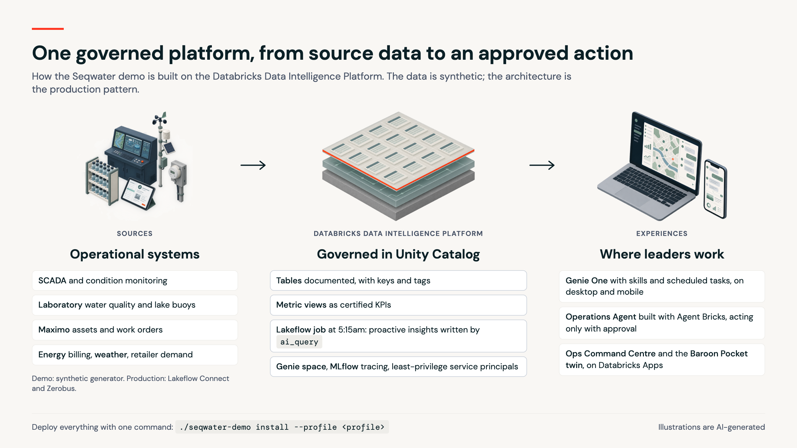

# Architecture



```
                        ┌──────────────────────────────── Experience ─────────────────────────────────┐
  Executive (laptop,    │  Genie One (web, desktop, mobile)            Seqwater Ops Command Centre    │
  phone)  ───────────►  │   • /seqwater-morning-briefing  (Skill)       (Databricks App)              │
                        │   • Scheduled task 6:30am → email + PDF       • briefing, KPIs, insight feed │
                        │   • follow-up questions                       • agent chat + approvals      │
                        └───────────────┬───────────────────────────────────────┬─────────────────────┘
                                        │ as the signed-in user                  │ /api/invocations (SSE)
                        ┌───────────────▼──────────────┐        ┌───────────────▼─────────────────────┐
                        │ Genie space                  │◄───────│ Seqwater Operations Agent           │
                        │ "Seqwater Operations         │ tool   │ Agent Bricks runtime (LangGraph)    │
                        │  Intelligence"               │        │ • 12 Seqwater tools (SQL)           │
                        │ instructions · certified SQL │        │ • Genie as a tool                   │
                        └───────────────┬──────────────┘        │ • memory + sessions stores          │
                                        │                       │ • human approval for actions        │
                                        │                       │ • MLflow tracing                    │
                                        │                       │ runs as app service principal       │
                                        │                       └───────────────┬─────────────────────┘
                        ┌───────────────▼───────────────────────────────────────▼─────────────────────┐
                        │ Unity Catalog: main.seqwater_demo                                            │
                        │  metric views (mv_*) ─ certified KPIs                                        │
                        │  proactive_insights · daily_briefing      ◄── ai_query narratives            │
                        │  18 documented tables, PK/FK, tags         agent_actions (approved actions)  │
                        └───────────────▲─────────────────────────────────────────────────────────────┘
                                        │
                        ┌───────────────┴─────────────────────────────────────────────────────────────┐
                        │ Lakeflow Job, daily 5:15am Brisbane (serverless)                             │
                        │  build_foundation → metric_views → proactive_insights → SQL alert 5:30am     │
                        │  (synthetic generator today; Lakeflow Connect / Zerobus feeds in production) │
                        └─────────────────────────────────────────────────────────────────────────────┘
```

## Components

| Component | Source | Deployed by | Identity |
|---|---|---|---|
| Synthetic data and docs | `data_platform/src/seqwater_synth.py`, `catalog_docs.py` | Bundle `seqwater-ai-demo-data` (serverless job) | Deploying user (job owner) |
| Metric views | `data_platform/src/metric_views.py` | Same job | Job owner |
| Proactive insights and briefing | `data_platform/src/proactive_insights.py`: SQL rules + `ai_query` | Same job | Job owner |
| Genie space | `genie_experience/build_space.py` → `.build/seqwater_ops.geniespace.json` | Bundle `seqwater-ai-demo-experience` (`genie_spaces`) | Questions run as the asking user |
| SQL alert | `genie_experience/resources/alerts.yml` | Same bundle (`alerts`) | Owner |
| Skills | `skills/*/SKILL.md` (`{{fq}}` rendered) | `databricks workspace import` → `/Users/<you>/.assistant/skills/` | Signed-in user |
| Agent | `ops_agent/agent/` (LangGraph, Agent Bricks) | `agentbricks deploy` → Databricks App `agent-bricks-<name>` | App service principal |
| Command Centre | `ops_agent/runtime/seqwater_ui.py`, `ops_agent/ui/cc/` | Same app | App service principal |
| Baroon Pocket twin | `ops_agent/ui/cc/twin.js` (three.js), assets in `ops_agent/ui/cc/twin/` built by `tools/`, data from `reservoir_*` tables via `/api/seqwater/twin` | Same app | App service principal |

## Security model

- **Genie One, the Genie space and skills** run with the user's own Unity Catalog permissions.
- **The agent app's service principal** gets `USE CATALOG`, `USE SCHEMA` and `SELECT` on the demo schema, `MODIFY` on `agent_actions` only, `CAN_USE` on the warehouse, `CAN_RUN` on the Genie space, and `EXECUTE` on the agent's model.
- **Approvals.** Tools that change the business (`raise_work_order`, `submit_regulator_notification`, `request_offtake_change`, `send_stakeholder_briefing`) are gated by LangGraph `HumanInTheLoopMiddleware`. The run pauses and the UI shows Approve / Reject. The approver's identity is recorded with the action.
- **Why the agent uses its own identity.** Agent Bricks 0.5 doesn't support approval pauses for request-user (on-behalf-of) invocations, so the agent runs as a least-privilege service principal instead.
- **Tracing.** Every agent run is traced to the MLflow experiment `/Shared/agentbricks_traces/seqwater-ops-agent`.

## From demo to production

| Demo | Production |
|---|---|
| `seqwater_synth.py` regenerates history daily | Lakeflow Connect, Zerobus, or partner connectors from SCADA/historian, LIMS, Maximo, billing, BoM into bronze/silver/gold |
| Insight rules over demo tables | The same rules over gold tables, tuned with operations, plus ML anomaly detection where it adds value |
| `agent_actions` table | Action tools call Maximo, the incident system, email or Teams APIs (still behind approval) |
| Single workspace, one profile | Bundles promoted dev → test → prod with CI/CD; the agent deployed by pipeline |
