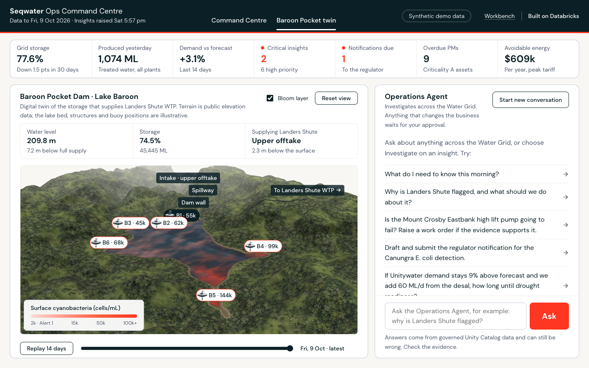
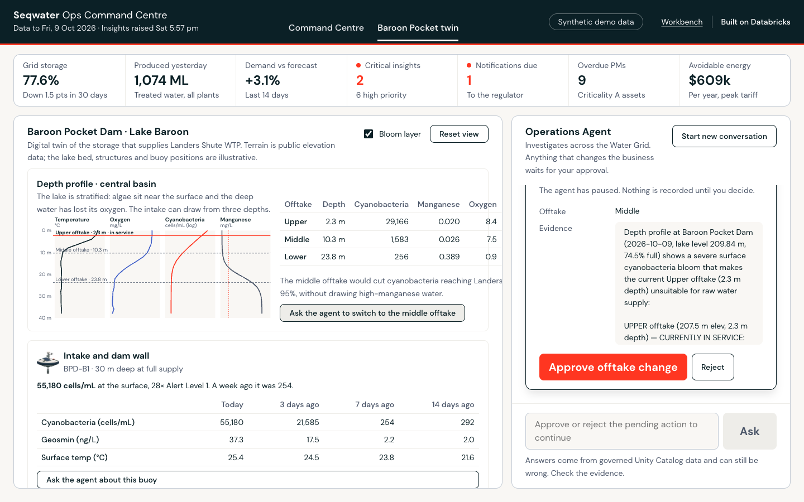
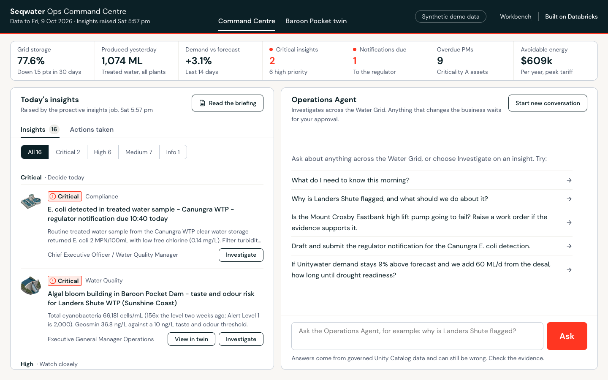
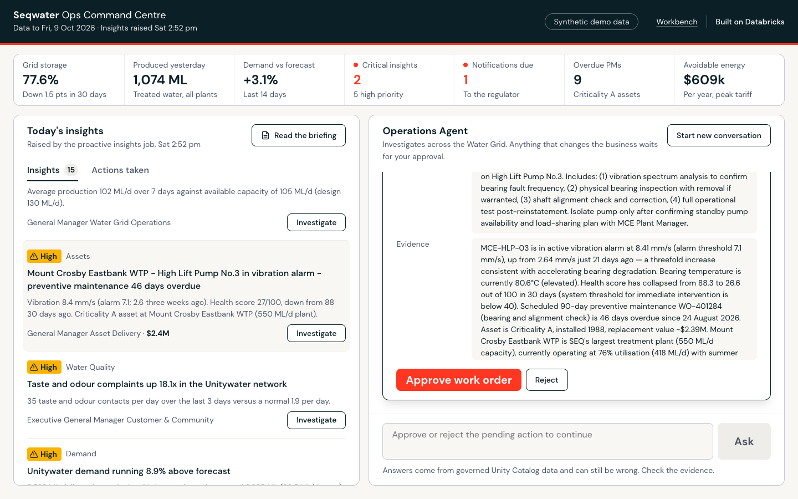
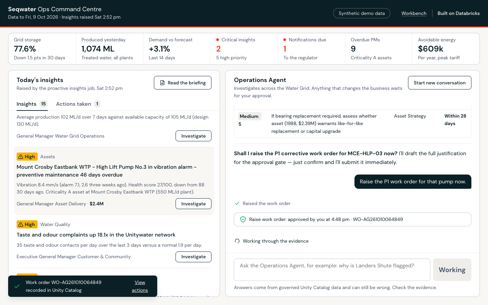

# Seqwater × Databricks: Partner Demo Runbook

**From reactive to proactive water operations**
Audience: Seqwater's CTO and Innovation Executive · Length: about 40 minutes · Presenter: partner · Setting: laptop and browser
Version 1.0 · October 2026 · Tested on Databricks on AWS

---

## 1. The demo at a glance

**The point.** Seqwater's leaders shouldn't have to go looking for problems in dashboards. With Databricks, the platform watches the whole Water Grid overnight and briefs the executive at 6:30am. When it's time to act, an agent investigates across every system, proposes the action, and does it after a human approves. All of it runs on one governed platform that Seqwater owns.

**What you will show**

| # | Moment | Databricks capability | Time |
|---|---|---|---|
| 0 | The problem | (talk track) | 2 min |
| 1 | The 6:30am briefing arrives by itself | **Genie One scheduled task** + **Skill** | 6 min |
| 2 | "Why?" Follow-up questions in plain English | **Genie One** over a governed **Genie space** + **metric views** | 5 min |
| 3 | A skill is just governed know-how | **Skills**: board paper, incident sitrep | 4 min |
| 4 | See it in place: the Baroon Pocket Dam twin | **Databricks App**: 3D twin over governed data | 6 min |
| 5 | The agent that acts, with approval | **Agent Bricks** agent in a **Databricks App** | 9 min |
| 6 | Under the hood, for the CTO | **Unity Catalog**, proactive insights job, MLflow traces, everything as code | 5 min |
| 7 | Close and next steps | | 2 min |

**The story in one breath.** A hot, dry spring has set off an algal bloom in Baroon Pocket Dam. That bloom is choking Landers Shute WTP and driving taste and odour complaints on the Sunshine Coast. Meanwhile Unitywater demand is running 9% over forecast, so Brisbane is pumping north through the Northern Pipeline Interconnector, and the pumping has drifted into peak tariff. Separately, a supply-critical high lift pump at Mount Crosby is in vibration alarm with its maintenance overdue, and an E. coli result at Canungra came in at 4:40am with a regulator deadline at 10:40. Today these signals sit in different systems owned by different teams. Here, they arrive as one briefing, already connected.

> **All data is synthetic.** Asset names are real Seqwater assets so the story lands; every number is generated. Say this once, early, and you won't get stuck on "is that our real number?"

---

## 2. One-time setup (partner, about 20 minutes)

1. **Workspace.** Use a Databricks workspace with Unity Catalog, serverless SQL and jobs, Genie One, Databricks Apps and Agent Bricks custom agents (Beta). The demo has been tested on AWS.
2. **Tools on your laptop.** Install the Databricks CLI v0.292+ (v1.x recommended), Python 3.10+ and [uv](https://docs.astral.sh/uv/).
3. **Authenticate.** `databricks auth login --host https://<workspace> --profile seqwater-demo`
4. **Install.** `./seqwater-demo install --profile seqwater-demo`. Add `--catalog <name>` if you can't create schemas in `main`. The install takes about 15 minutes and prints every link you need.
5. **Check.** `./seqwater-demo status --profile seqwater-demo` should show *data through yesterday*, about 15 proactive insights, and the app *RUNNING*.

What the installer creates (all in your workspace, and all removable with `uninstall`):

| Asset | Name |
|---|---|
| Schema with 23 tables + 8 metric views | `main.seqwater_demo` |
| Daily job (5:15am Brisbane) | *Seqwater AI demo - daily refresh and proactive insights* |
| Genie space | *Seqwater Operations Intelligence* |
| SQL alert (5:30am, emails you) | *Seqwater - critical operational insight raised* |
| Skills | `/seqwater-morning-briefing`, `/seqwater-incident-sitrep`, `/seqwater-board-water-security` |
| Databricks App (agent + Command Centre) | `agent-bricks-seqwater-ops` |

---

## 3. Pre-meeting checklist

**The day before**

- ☐ `./seqwater-demo status`: data is current. If not, run `./seqwater-demo refresh`.
- ☐ **Create the scheduled task** (this is what you'll show in Act 1):
  Genie One → **Schedules** → **Create manually**
  - *Title:* `Seqwater Morning Operations Briefing`
  - *Instructions:* `Use the seqwater-morning-briefing skill to produce this morning's Seqwater Morning Operations Briefing.`
  - *Schedule:* weekdays, 6:30 am, timezone *Australia/Brisbane*
  Then click **Run now** once, so a finished run (and its email with the PDF) exists to show.
  *Alternative:* in Genie One chat, type: `Every weekday at 6:30am Brisbane time, run the seqwater-morning-briefing skill and email me the result.`
- ☐ Run each skill once in Genie One so it's warm: `/seqwater-morning-briefing`, `/seqwater-incident-sitrep` (Canungra), `/seqwater-board-water-security`.
- ☐ In the Command Centre, ask one question so the app is warm, and open **Baroon Pocket twin** once so the 3D assets are cached.

**60 minutes before**

- ☐ `./seqwater-demo reset --profile seqwater-demo` to clear previous agent actions, so the work order, notification and offtake change are fresh in Acts 4 and 5.
- ☐ Open these browser tabs, in this order:
  1. **Genie One**: `https://<workspace>/one`
  2. The **email** from the scheduled task run, with its PDF attached (optional but powerful)
  3. **Ops Command Centre**: the app URL from `status`
  4. **Catalog Explorer**: `main.seqwater_demo` (for Act 6)
  5. **Jobs**: *Seqwater AI demo - daily refresh* (for Act 6)
  6. **MLflow experiment**: `/Shared/agentbricks_traces/seqwater-ops-agent` (for Act 6)
- ☐ Browser zoom at 110–125%, notifications off, full screen.
- ☐ *Optional:* the Databricks (Genie) mobile app signed in on your phone, to show the same briefing on mobile.

---

## 4. Demo script

Each act has the same parts:
- **Say**: the talk track.
- **Do**: the clicks.
- **Call out**: the value, and the Databricks capability behind it.
- **If it goes wrong**: what to do instead.

### Act 0: The problem (2 min)

**Say:** "Seqwater runs 25-plus dams, more than 30 treatment plants, the desal plant, the Western Corridor scheme and 600 km of Water Grid pipeline. Every morning your leaders piece together the picture from lab results, SCADA, Maximo, energy bills, retailer demand, capital reports and the incident log. Each one is owned by a different team, and the connections between them usually turn up late. Today I'll show you that picture arriving by itself, already joined up, and an AI agent that can act on it safely. We'll go past dashboards: agents, apps and proactive insights, on a platform that Seqwater governs."

**Call out:** We're not replacing your systems. We sit across them, governed by Unity Catalog.

### Act 1: The 6:30am briefing (6 min)

**Do:**
1. In **Genie One**, open **Schedules** → *Seqwater Morning Operations Briefing*. Show the schedule (weekdays 6:30am) and the instruction ("use the seqwater-morning-briefing skill").
2. Open the latest **run**. Optionally switch to the **email** tab and show the PDF.
3. Walk the briefing top to bottom:
   - **Bottom line**
   - **KPI strip**: grid storage about 77.6%, 1.5 points down in 30 days
   - 🔴 **Needs a decision today**: Canungra E. coli (notification due 10:40) and the Baroon Pocket bloom
   - 🟠 **Watch closely**: Landers Shute at 97% of available capacity, Unitywater +9%, the Mount Crosby pump in alarm
   - 🟡 energy, capital and backlog items
   - 🟢 **PFAS assurance**
   - **How it connects**

**Say:** "Nobody wrote this. At 5:15am a Databricks job refreshed the data and ran the proactive insights engine: rules that look for what changed, size the impact and recommend an owner. At 6:30 Genie One ran a **skill** that turns those insights into the executive's preferred briefing format. It lands in your inbox and on your phone."

**Call out:**
- Proactive, not reactive. Insights find the executive; nobody has to go looking.
- **Skills** carry Seqwater's own way of briefing: structure, tone, severity rules.
- The **"How it connects"** paragraph is the cross-silo story no single dashboard shows.
- The same briefing is on the mobile app, with push notifications on iOS.

**If it goes wrong:** If the scheduled run isn't there, type `/seqwater-morning-briefing` in Genie One chat and run it live. It takes about 60–90 seconds, so talk through Act 0 while it runs.

### Act 2: Ask "why?" in plain English (5 min)

**Do:** In Genie One chat, in the same thread as the briefing, ask:
1. `Why is Landers Shute flagged, and what is driving it?`
   *Expect:* it connects the bloom (cyanobacteria about 66,000 cells/mL, geosmin about 37 ng/L), the capacity cut (about 105 of 130 ML/d available), complaints up about 18× and Unitywater demand +9%.
2. `Show me cyanobacteria and geosmin in Baroon Pocket Dam over the last 30 days`
   *Expect:* a chart or table rising sharply over the last 12 days.
3. `What happened at Mount Crosby during the last major turbidity event, and how did the desal respond?`
   *Expect:* last summer's event: raw turbidity above 1,500 NTU, Mount Crosby derated to about 40%, Gold Coast desal ramped toward capacity.
4. `What is grid storage now, how does it compare to this time last year, and how many days until the drought readiness level?`
   *Expect:* about 77.6% now versus about 74.7% a year ago, and about 150 days to the 70% demo trigger.

**Say:** "That's Genie One. It's grounded in a governed Genie space and certified **metric views**, so 'grid storage' means the same thing for everyone, the board included. Every answer shows its SQL. And it only sees what *you're* allowed to see in Unity Catalog."

**Call out:**
- No dashboard was built for these questions.
- **Metric views** give one definition of each KPI, so you're not reconciling three spreadsheets.
- Follow-ups keep their context. Click **Show SQL** to show the transparency.
- The CTO angle: it inherits Unity Catalog permissions, so there are no new data copies.

### Act 3: Skills are governed know-how (4 min)

**Do:**
1. Type `/seqwater-board-water-security`. *Expect:* a Board paper with Purpose, Recommendation, a grid storage table, a dam-by-dam table, demand versus forecast, desal readiness and a trigger outlook.
2. *Or*, for an operations audience: `/seqwater-incident-sitrep Canungra E. coli`. *Expect:* a SITREP with the regulatory obligation in bold and decisions you can answer yes or no.
3. Open **Customizations → Skills** and show that the skill is a markdown file: instructions, structure, governed SQL.

**Say:** "A skill is how Seqwater teaches the AI to work the way Seqwater works: the board paper format, the incident sitrep, the morning brief. Your people write it in plain English. It's versioned like code, and with Unity Catalog skills it can be shared and governed like a table."

**Call out:**
- Innovation angle: the business authors skills, not IT.
- CTO angle: skills live in the workspace, so you can review them, version them, and govern sharing through Unity Catalog (Beta).

### Act 4: See it in place, the Baroon Pocket Dam twin (6 min)

**Do:**
1. In the Ops Command Centre, on the **Algal bloom building in Baroon Pocket Dam** insight, click **View in twin**. Or click **Baroon Pocket twin** in the top bar.
2. Orient the room: real terrain from public elevation data, Lake Baroon at today's level (about 209.8 m, 7.2 m below full supply), the dam wall, the intake tower, and the pipeline to Landers Shute WTP. Drag to rotate; scroll to zoom.
3. Click **Replay 14 days**. *Expect:* the lake starts clear. The bloom appears in the Obi Obi Creek inflow arm (buoy B5) and drifts toward the intake, with buoy readings climbing from hundreds to tens of thousands of cells/mL.
4. Click a buoy (B1, at the intake) to show its readings: today, 3, 7 and 14 days ago.
5. Scroll to **Depth profile · central basin**. The lake is stratified: the algae sit in the top few metres, and the deep water has lost its oxygen and picked up manganese.
   - The **upper offtake** (in service) is about 2.3 m deep, inside the bloom (about 29,000 cells/mL).
   - The **middle offtake** (about 10 m) has about 95% less algae, with low manganese. It's marked **Best quality**.
   - The **lower offtake** (about 24 m) is in low-oxygen water with manganese about 4× the guideline.
6. Click **Ask the agent to switch to the middle offtake**. The agent reads the profile and requests the change. Click **Approve offtake change**. *Expect:* a toast with `OFT-…`, the intake label turns to "Intake · middle offtake", the profile shows the middle offtake in service, and the change appears in **Actions taken**.

**Say:** "This is the same governed data Genie and the agent use, the buoys, the depth profile and the intake levels, shown in place. The decision the morning briefing recommended, 'draw from the best-quality layer', is made here, with the evidence on screen and a human approving it."

**Call out:**
- A digital twin is a decision surface, not a 3D picture. Every layer is a Unity Catalog table.
- It runs as a Databricks App, so it opens in the browser and in the Genie mobile app.
- Terrain is public elevation data; the lake bed, structures and buoy positions are illustrative. Say so if asked.

**If it goes wrong:** If 3D doesn't load (no WebGL), the page still shows the depth profile and buoy readings. Use those, and the agent, for the offtake decision.

### Act 5: The agent that acts, with approval (9 min)

**Do:** Switch to the **Ops Command Centre** tab.
1. Orient the room: the status strip, today's insights grouped by severity (the same ones as the briefing), the agent on the right, and the **Actions taken** tab.
2. On the **Mount Crosby Eastbank High Lift Pump No.3** insight, click **Investigate**. Or ask:
   `Is the Mount Crosby Eastbank high lift pump going to fail? Raise a work order if the evidence supports it.`
   - *Expect:* the agent's steps appear as it works ("Checking asset health for MCE-HLP-03"). Then the evidence: vibration 8.4 mm/s (alarm 7.1), health 27/100 (down from 88), PM 46 days overdue, criticality A. If it asks first, reply `Raise the P1 work order now.` An **Approval needed: Raise work order** card then shows the full work order. The chat box is locked until you decide.
   - Click **Approve work order**. *Expect* an approval receipt with the reference (`WO-AG…`), a confirmation toast, and the **Actions taken** count going up. Click **View actions** in the toast to show the log.
3. Ask: `Draft and submit the regulator notification for the Canungra E. coli detection.`
   - *Expect:* a complete, professional notification in an approval card. Click **Approve notification**. *Notifications due* in the status strip drops from 1 to 0.
4. Ask: `If Unitywater demand stays 9% above forecast and we add 60 ML/d from the desal, how long until drought readiness?`
   - *Expect:* a table of days per trigger, base case versus scenario.
5. Optional: `How much could we save by moving transfer pumping out of peak tariff?` *Expect:* about $0.6M a year, by pump station.

**Say:** "This agent was built with the **Agent Bricks CLI** in a few hundred lines of Python. It has 12 Seqwater tools, it uses the same Genie space as a tool, and it remembers the user. The important part: anything that changes the business, like a work order, a regulator notification or a briefing to a retailer, stops for a human to approve. It runs as its own service principal with least privilege, and it's deployed as a Databricks App, so it also runs inside the Genie One mobile app."

**Call out:**
- **Agents that act, safely.** Human in the loop is enforced by the platform, not by a prompt.
- Every step is traced in MLflow (Act 6), so it's auditable.
- The action log lives in Unity Catalog, and work orders flow into the `work_orders` table that Genie can query.
- Speed: this is a template a partner can extend in weeks, not a 12-month build.

**If it goes wrong:**
- If the agent is slow (more than 30 seconds), narrate the steps as they appear. They show its reasoning.
- If it asks "shall I proceed?" instead of showing an approval card, reply `Yes, raise it.`
- If the app errors, open `/workbench` on the same URL (the Agent Bricks developer UI) and ask the same question.
- Last resort: show the same thing in Genie One with `/seqwater-incident-sitrep`.

### Act 6: Under the hood, for the CTO (5 min)

**Do:**
1. **Catalog Explorer** → `main.seqwater_demo`:
   - Open `mv_water_security` (a metric view, YAML, certified tag).
   - Open `proactive_insights` and show the column comments, tags, and lineage to the source tables.
   - Show the PK/FK on `assets`.
2. **Jobs** → *daily refresh*. Show the three tasks: build data → metric views → proactive insights (rules plus `ai_query`).
3. **MLflow** → the agent experiment. Open a trace and show each tool call, the SQL, the latency and the approval. *Check this the day before:* if the workspace restricts serverless or app network egress, trace payloads may not upload. If so, show the action log and the Agent Bricks `/workbench` (sessions, memory) instead.
4. Optional: in the repo, show `agent.toml` (tools, memory, sessions, tracing declared in about 20 lines) and the one-command install.

**Say:** "Everything you saw is governed in Unity Catalog and deployed as code: two bundles, one agent, three skill files, one command. It runs in Seqwater's own tenancy, fits the platform and DevOps practices you already have, and is the kind of thing your delivery partner can take to production."

**Call out:**
- **Security:** Unity Catalog permissions everywhere; least-privilege service principal for the agent; human approval for actions; full audit trail.
- **Open:** LangGraph, MLflow, Delta and SQL, so there's no lock-in on the agent code.
- **Cost control:** serverless, scale to zero, and one small job a day.
- **Path to real data:** swap the synthetic generator for Lakeflow Connect or Zerobus feeds from SCADA, LIMS, Maximo and billing. Every layer above stays the same.

### Act 7: Close (2 min)

**Say:** "Three places Seqwater could start, each 8 to 12 weeks with a partner:
1. **Water quality early warning**: algae, taste and odour, turbidity, with insights and sitreps to operations and the executive.
2. **Asset risk agent**: condition data plus Maximo work orders, with approval-gated work orders.
3. **Executive morning briefing**: Genie One and skills over the KPIs you already report to the Board.

Which of those matters most to you this summer?"

---

## 5. Questions you may get

| Question | Answer |
|---|---|
| Is this our data? | No. It's synthetic, built on public asset names. The design is what's real: swap in your feeds and the layers above stay the same. |
| Can it hallucinate? | Answers are grounded in governed tables, Genie shows its SQL, and the agent quotes tool results. Actions need approval. Agent quality is evaluated with MLflow (evaluation datasets and judges). |
| Who can see what? | Genie One and skills run as the signed-in user, under Unity Catalog permissions. The agent runs as a service principal with read access to one schema and write access to one table. |
| How does it reach Maximo, SCADA or LIMS? | Read: Lakeflow Connect, Zerobus or partner connectors into Unity Catalog. Write: the agent's action tools call the system API (here they write to a governed table). |
| Data residency and models? | It runs in your Databricks workspace region. Model choice is configurable (Claude, GPT, Llama and others) through the AI Gateway, with governance and rate limits. |
| Azure? | Seqwater can run this on Azure Databricks. This demo build was tested on AWS. |
| How long to build for real? | The demo itself took days. A production pilot on one use case typically takes 8–12 weeks with a partner. |
| Cost? | Serverless and usage based. The demo runs one small job a day plus one app; pilots are sized per use case. |

---

## 6. Troubleshooting and reset

| Symptom | Fix |
|---|---|
| Briefing shows yesterday's date, or no insights | `./seqwater-demo refresh`, then re-run the skill |
| Insight narratives look like templates (no AI prose) | The `ai_query` endpoint is unavailable. Reinstall with `--llm-endpoint <an endpoint that supports batch inference>` |
| Agent error "model does not exist" | The app service principal needs `EXECUTE` on the model. Reinstall with `--agent-model system.ai.<available model>` |
| Command Centre shows "Could not load data" | Check the app is running (`status`); re-run `install --skip-data` to re-apply grants |
| Skill not found in Genie One | Skills install for the user who ran `install`. Present as that user, or copy `.build/skills/` to your own `/Users/<you>/.assistant/skills/` |
| MLflow traces list but won't open ("failed to download trace data") | The app couldn't upload trace payloads to workspace storage, usually because of serverless/app egress restrictions. Allow it in the workspace network policy, or skip traces in Act 6 |
| The twin shows "Couldn't load the twin" | The reservoir tables are missing: run `./seqwater-demo refresh`. Then check the browser supports WebGL (any recent Chrome, Edge or Safari) |
| Want a clean slate | `./seqwater-demo reset` (actions only), or `uninstall` then `install` |

---

## 7. Appendix

### Data model (schema `seqwater_demo`)

- **Reference:** `sites` (39 dams, plants, desal, AWTPs, pump stations), `retailers` (5), `assets` (about 100), `water_quality_guidelines`, `drought_trigger_levels`
- **Baroon Pocket twin:** `reservoir_buoys`, `reservoir_buoy_readings_daily`, `reservoir_profile_daily`, `reservoir_offtakes`, `reservoir_level_daily`
- **Daily facts (2 years to yesterday):** `storage_levels_daily`, `treatment_daily`, `bulk_supply_daily`, `energy_daily`, `asset_condition_daily`, `customer_contacts_daily`, `weather_daily` (with a 7-day forecast)
- **Events:** `water_quality_samples`, `work_orders`, `incidents`, `capital_projects`, `capital_spend_monthly`
- **AI outputs:** `proactive_insights`, `daily_briefing`, `agent_actions`
- **Metric views:** `mv_water_security`, `mv_water_quality`, `mv_treatment`, `mv_bulk_supply`, `mv_energy`, `mv_asset_health`, `mv_work_orders`, `mv_capital_program`

### Prompt bank

**Genie One**
- `Give me this morning's operations briefing`
- `Which pumps are at highest risk of failure, and is their maintenance overdue?`
- `Which Dam Improvement Program projects are over budget, and by how much?`
- `How much did treatment chemicals cost at Landers Shute this month compared with last month?`
- `Show taste and odour complaints by retailer for the last 30 days`
- `Is there any PFAS concern in our treated water?`

**Twin (Baroon Pocket)**
- `Which Baroon Pocket offtake has the best water quality right now?`
- `How fast is the bloom spreading toward the intake?`
- `Switch Landers Shute to the middle offtake.` (approval card)

**Agent (Command Centre)**
- `What do I need to know this morning?`
- `Investigate Landers Shute and recommend what we do in the next 24 hours`
- `Send Unitywater a short briefing on the taste and odour event and what we are doing`
- `Remember that I prefer the financial impact first`, then in a new conversation: `What's the most expensive issue right now?`

### Expected numbers (approximate; they're recalculated every morning)

| Metric | About |
|---|---|
| Grid storage | 77.6%, down 1.5 points in 30 days; about 150 days to 70% |
| Baroon Pocket cyanobacteria / geosmin | ~66,000 cells/mL / ~37 ng/L |
| Landers Shute | 97% of available capacity, about 19% of design lost |
| Unitywater demand vs forecast | about +9% (14 days) |
| Mount Crosby HLP-3 | 8.4 mm/s, health about 27, PM 46 days overdue |
| Peak-tariff pumping | about 33% peak share against a 20% target, about $0.6M a year avoidable |
| Canungra E. coli | 2 MPN/100mL, reported 04:40, notification due 10:40 |
| Lake Baroon level | about 209.8 m, 7.2 m below full supply (74.5% full) |
| Offtakes (upper / middle / lower) | about 2.3 / 10.3 / 23.8 m deep; algae about 29,000 / 1,600 / 250 cells/mL; manganese 0.02 / 0.03 / 0.39 mg/L |
